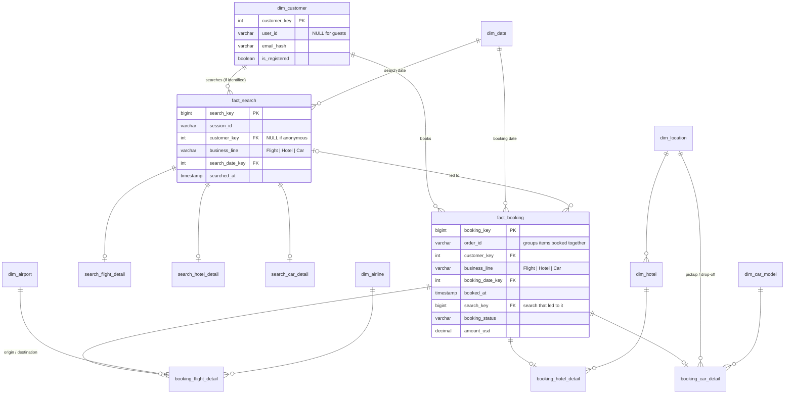

# Part A: XYZ Travel Data Warehouse

All the SQL below is also in [`sql/part_a/`](../sql/part_a/) as runnable files (table definitions are in `01_schema.sql`). I ran and tested everything in DuckDB with a small sample dataset.

## How I approached it

On XYZ's website, people do two things: they **search** and they **book**. That happens across three business lines (**Flight, Hotel, Car**), and the person can be a **registered** user or a **guest**. So I built the model around those three things: searches, bookings, and customers.

---

## Q1. Data model

It's a star schema with two fact tables, one for searches and one for bookings. Each fact has a main (**header**) table with the fields every search or booking has, and then one **detail** table per business line for the fields that only that line has.



*(Detail tables: `search_flight_detail` has origin/destination airport, departure date and time window, passengers. `search_hotel_detail` has location, check-in/out and rooms. `search_car_detail` has pickup location and dates, car model and passengers. The `booking_*_detail` tables have the same idea for what was actually booked, like airline, hotel, exact times and nights. All columns are in `01_schema.sql`.)*

| Table | Grain (one row = …) |
|---|---|
| `fact_search` (+ 3 detail tables) | one search on the site |
| `fact_booking` (+ 3 detail tables) | **one booked item**: a flight, a hotel stay, or a car rental |
| `dim_customer` | one customer, registered or guest |
| `dim_date` | one calendar day |
| `dim_airport`, `dim_airline`, `dim_location`, `dim_hotel`, `dim_car_model` | one airport / airline / city / hotel / car model |

### Design decisions

1. **Searches have their own fact table.** Not every search ends in a booking, and that's exactly the interesting part. Bookings tell us what people bought, searches tell us what they wanted. With both, XYZ can see its conversion rate and the demand it's missing.
2. **One row in `fact_booking` is one booked item** (a flight, a hotel stay or a car rental). I picked this grain because it works for all three lines, since hotels and cars don't have passengers, and the price is stored only once, so nothing gets double counted. If someone books a flight and a hotel together, that's two rows with the same `order_id`. Passengers and rooms are just columns.
3. **Header + detail tables.** The common fields (who, when, how much, which line) sit in the header, so a question across all lines like Q3 is just a `GROUP BY business_line`. Fields that only one line has go in that line's detail table. That way there's no huge table with mostly empty columns, and a line can add new fields without touching the others. I also thought about one wide table for everything. It would work, but most columns would be empty for most rows, and it gets messy as the lines grow.
4. **Guests are customers too.** Everyone in `dim_customer` gets a warehouse ID (`customer_key`), and registered users also keep their website `user_id`. Email is required for every booking, so I use a **hashed email** to recognise a guest who comes back, and the plain email is never stored. If a guest registers later, their old bookings get linked to the new account so the history isn't lost. Searches from visitors who aren't logged in are grouped by `session_id`, and get linked to a customer once they log in or book.
5. **Each booking points to the search that led to it** (`fact_booking.search_key`). During the load, a booking is linked to the latest matching search in the same session. This link is what makes the conversion query possible.
6. **One date table, used for every date.** The same `dim_date` covers booking, search, departure, check-in/out and pickup/drop-off dates (a role-playing dimension). In the same way, `dim_hotel` points to `dim_location` for its city, so city details are stored in one place.
7. **Cancellations are a status, not a delete.** `booking_status` keeps the history, and each query decides whether to count cancelled bookings.

**Assumptions:** I used the fields in the brief, plus airline, amount and booking status, since any real booking has those. If a customer's details change (say, a new phone number), I just overwrite the old value, because nothing in the brief needs history (SCD Type 1). If XYZ needed to keep old values, I'd add a new row per change with start and end dates instead (SCD Type 2).

---

## Q2. Two most valuable queries

**1. Search-to-booking conversion, by month, business line and customer type**

Basically: out of all searches, what % turned into a booking? For a travel site this is the main health check. Split by business line, it shows where people drop off between searching and booking. Split by registered vs guest, it shows whether it's worth pushing guests to create an account.

```sql
WITH searches AS (
    SELECT DATE_TRUNC('month', s.searched_at) AS month, s.business_line,
           CASE WHEN c.is_registered THEN 'Registered' ELSE 'Guest / anonymous' END AS customer_type,
           COUNT(*) AS searches
    FROM fact_search s
    LEFT JOIN dim_customer c ON c.customer_key = s.customer_key
    GROUP BY 1, 2, 3
),
bookings AS (
    SELECT DATE_TRUNC('month', s.searched_at) AS month, s.business_line,
           CASE WHEN c.is_registered THEN 'Registered' ELSE 'Guest / anonymous' END AS customer_type,
           COUNT(DISTINCT b.search_key) AS converted_searches
    FROM fact_booking b
    JOIN fact_search s       ON s.search_key = b.search_key
    LEFT JOIN dim_customer c ON c.customer_key = s.customer_key
    WHERE b.booking_status <> 'Cancelled'
    GROUP BY 1, 2, 3
)
SELECT s.month, s.business_line, s.customer_type, s.searches,
       COALESCE(b.converted_searches, 0) AS converted_searches,
       ROUND(100.0 * COALESCE(b.converted_searches, 0) / s.searches, 2) AS conversion_pct
FROM searches s
LEFT JOIN bookings b
       ON  b.month = s.month
       AND b.business_line = s.business_line
       AND b.customer_type = s.customer_type
ORDER BY s.month, s.business_line, s.customer_type;
```

**2. Cross-sell: of the orders that include a flight, what % also include a hotel or a car?**

This tells XYZ whether people book their whole trip with them or just the flight. If the % is low, that's a clear reason to offer "add a hotel?" at checkout. It also uses `order_id`, which groups everything booked together in one order.

```sql
WITH orders AS (
    SELECT order_id,
           DATE_TRUNC('month', MIN(booked_at))                       AS month,
           MAX(CASE WHEN business_line = 'Flight' THEN 1 ELSE 0 END) AS has_flight,
           MAX(CASE WHEN business_line = 'Hotel'  THEN 1 ELSE 0 END) AS has_hotel,
           MAX(CASE WHEN business_line = 'Car'    THEN 1 ELSE 0 END) AS has_car
    FROM fact_booking
    WHERE booking_status <> 'Cancelled'
    GROUP BY order_id
)
SELECT month,
       SUM(has_flight) AS flight_orders,
       ROUND(100.0 * SUM(CASE WHEN has_flight = 1 AND has_hotel = 1 THEN 1 ELSE 0 END)
             / NULLIF(SUM(has_flight), 0), 2) AS pct_with_hotel,
       ROUND(100.0 * SUM(CASE WHEN has_flight = 1 AND has_car = 1 THEN 1 ELSE 0 END)
             / NULLIF(SUM(has_flight), 0), 2) AS pct_with_car
FROM orders
GROUP BY month
ORDER BY month;
```

**What I'd add next:** routes that get searched a lot but rarely booked (demand XYZ is missing), revenue by business line and month, and cancellation rate by business line.

---

## Q3. Percentage growth in bookings by year and business line

```sql
WITH yearly AS (
    SELECT d.year, b.business_line, COUNT(*) AS bookings
    FROM fact_booking b
    JOIN dim_date d ON d.date_key = b.booking_date_key
    WHERE b.booking_status <> 'Cancelled'
    GROUP BY d.year, b.business_line
),
spine AS (                      -- every year x business line, even with zero bookings
    SELECT y.year, l.business_line
    FROM (SELECT DISTINCT year FROM dim_date
          WHERE year BETWEEN (SELECT MIN(year) FROM yearly)
                         AND (SELECT MAX(year) FROM yearly)) y
    CROSS JOIN (VALUES ('Flight'), ('Hotel'), ('Car')) AS l (business_line)
),
filled AS (
    SELECT s.year, s.business_line, COALESCE(y.bookings, 0) AS bookings
    FROM spine s
    LEFT JOIN yearly y ON y.year = s.year AND y.business_line = s.business_line
)
SELECT year, business_line, bookings,
       LAG(bookings) OVER w AS prev_year_bookings,
       ROUND(100.0 * (bookings - LAG(bookings) OVER w)
             / NULLIF(LAG(bookings) OVER w, 0), 2) AS pct_growth
FROM filled
WINDOW w AS (PARTITION BY business_line ORDER BY year)
ORDER BY business_line, year;
```

**Notes:**
- "Bookings" here means booked items (the fact grain), counted by the year they were booked, without cancellations.
- The **spine** is a full list of every year × business line, built before looking at bookings. So a year with zero bookings still shows up as 0, and growth is always compared with the year right before. Without it, a line with no bookings in a year would quietly get compared with an older year and the % would be wrong.
- `NULLIF(..., 0)` gives `NULL` instead of a divide-by-zero error when the previous year had no bookings.
- The current year isn't finished, so for a fair comparison I'd compare year-to-date with the same period last year.

---

## Q4. If booking volume grew suddenly overnight, what breaks first?

**First, I'd check that the jump is real.** A big overnight jump could just as easily be bots, a bug creating duplicate bookings, or a tracking issue. A simple check in the pipeline would catch it: compare today's bookings with the average of the last 30 days and alert if it's way higher (say 3×). Then look for duplicate orders, a lot of bookings from one source, or bookings with no matching payment.

**If it is real, this is the order I'd expect things to break:**

1. **The nightly load.** If the nightly job reloads everything, it keeps getting slower until it's not done by morning, and dashboards show old numbers. `fact_search` hits this first, because there are many more searches than bookings.
   *Fix:* load only the new rows since the last run, in a way that a re-run doesn't create duplicates. And load in small batches through the day (for example Snowpipe in Snowflake) instead of one big nightly job.
2. **Reports get slow.** Queries read the whole fact table, so they slow down as it grows.
   *Fix:* cluster the fact tables by date, since almost every query filters on dates, and add small summary tables (like daily bookings by line) for dashboards.
3. **Loading and reporting fight for the same compute.**
   *Fix:* give each its own compute (separate Snowflake warehouses) that can scale up during spikes.
4. **Matching guests gets slow.** Looking up each guest's email hash one row at a time doesn't scale.
   *Fix:* match the whole batch in one join, and cluster the customer table by `email_hash` so the lookup is fast.

**In short:** the data model itself doesn't need to change. What changes is how the data is loaded (only new rows, small batches, safe to re-run) and how it's stored and served (clustered by date, summary tables, separate compute).
