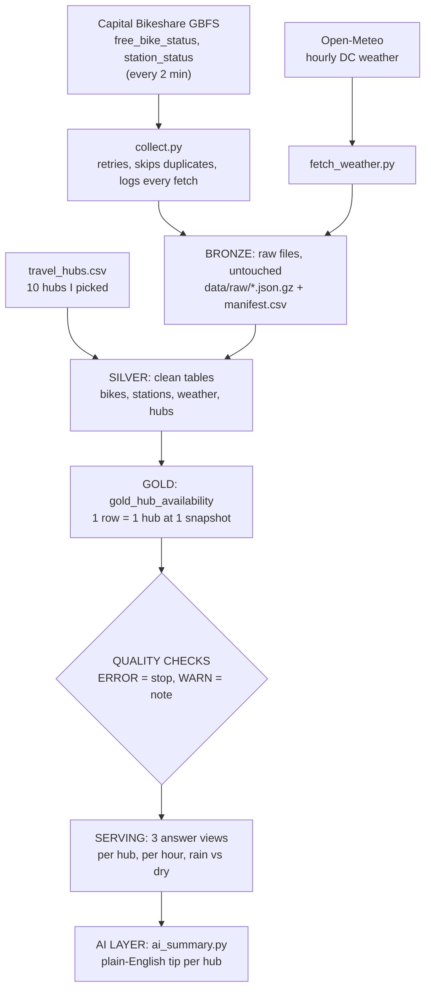

# Part B: Capital Bikeshare pipeline

XYZ wants to know if bikes can help their customers with the last mile, like getting from the train station or airport to their hotel. So I built the pipeline around one question: **when a traveller arrives at a DC travel hub, can they find a bike nearby?**

All numbers below are from my own live collection, about 30 hours (Fri Oct 16, 2 PM to Sat Oct 17, 8 PM DC time), one snapshot every ~2 minutes. The collector is still running, so these will firm up with more data.

---

## Architecture

**How it runs today (on my laptop):** Python collects the data and saves it raw, then `build_warehouse.py` runs the SQL in DuckDB (silver, then gold, then the quality checks). The raw files are never changed, and the whole warehouse is rebuilt from them on every run, so running it twice gives the same result.

**How I'd run it in production:** the same layers, just bigger tools.

| Layer | On my laptop | In production |
|---|---|---|
| Schedule | `collect.py` loop (every 2 min) | EventBridge timer |
| Ingest | `collect.py`, `fetch_weather.py` | Lambda |
| Bronze | `data/raw/` folders | S3 |
| Silver / gold / checks | DuckDB SQL files | Snowflake (Snowpipe loads the files) + dbt (runs the SQL in order) |
| Running the steps in order + alerts | run by hand | Airflow |
| Where people see the results | answer views + `docs/ai_summary.md` | dashboard + AI summary |

The SQL is mostly standard, so it would move to Snowflake with small changes (Snowflake also has `ASOF JOIN` and `QUALIFY`).

### The AI layer

- **Where it sits:** at the very end, on top of gold, where the results get shown.
- **What it reads:** only the small answer views (per hub, per hour). Never the raw data.
- **What it produces:** a short plain-English tip per hub for a traveller, saved to [`docs/ai_summary.md`](ai_summary.md). For example: *"Union Station: always had bikes nearby; returning a bike is the tight spot, lowest around 3 PM."*

**Why there:** the AI only explains numbers the pipeline already calculated and checked. It never does the maths, so it can't make up figures, and it only reads a few hundred numbers, so it's cheap. If there's no API key or the call fails, a simple template writes the summary instead, so the pipeline never breaks because of the AI step.

**Where I'd take it next:** let XYZ staff ask questions in plain English ("which hubs are tight on Friday evenings?") and have the AI answer by querying the gold tables.

---

## Data sources

| Source | What it is | Why I chose it | What it adds |
|---|---|---|---|
| **Capital Bikeshare GBFS** (`free_bike_status`, `station_status`, plus `station_information` and `vehicle_types` for reference) | The live public feed: where every dockless bike is, and bikes / e-bikes / empty docks at every station | Required by the brief. `free_bike_status` alone only shows dockless bikes, so I added `station_status` to also see docked bikes and empty docks | The core data: what's available, where, and when |
| **Travel hubs** (`reference/travel_hubs.csv`, 10 hubs) | Union Station, Reagan Airport, Metro Center, Convention Center, L'Enfant Plaza, Smithsonian, Foggy Bottom, Farragut Square, Crystal City, Rosslyn. Coordinates taken from the Capital Bikeshare station that serves each one | XYZ's customers are travellers, and these are the places they arrive | **Where** a traveller needs a bike. This turns "bikes in DC" into "bikes for XYZ's customers" |
| **Open-Meteo** (hourly DC weather) | Free weather API, no key needed, has history | Weather is one of the biggest drivers of bike use (the well-known UCI bike-sharing dataset is actually Capital Bikeshare data), and it's the only "when" source that is free, has history and is hourly | **When**: does rain or cold change what's available? |

---

## Q5. What question did I answer, and how does the pipeline support it?

**The question:** *When an XYZ traveller arrives at a DC travel hub, can they find a bike within a 5-minute walk (400 m), an e-bike with enough battery, and an empty dock to return it? And does that change by time of day or with rain?*

I picked it because it's exactly XYZ's last-mile use case, and it turns the raw feed into something a travel company could act on, like telling customers where bikes are a good option and when to avoid them.

**How the pipeline and schema support it:**

1. **Collect every 2 minutes** (`collect.py`). Each run saves a full **snapshot**: where every bike is and what every station has. The feed has no history, so the only way to see patterns over time is to record it myself.
2. **Silver** turns the raw files into one row per bike per snapshot and one row per station per snapshot.
3. **Gold** answers the question directly. The main table `gold_hub_availability` has **one row per hub per snapshot**, with:
   - `total_bikes` (docked + dockless within 400 m)
   - `ebikes_available` (docked e-bikes + dockless e-bikes with at least 5 km of battery)
   - `open_docks` (empty docks within 400 m, at stations accepting returns)
   - the weather for that hour
4. A few design choices make the numbers trustworthy:
   - **Every snapshot × every hub** gets a row, so a moment with zero bikes shows up as 0 instead of disappearing.
   - The bike and station feeds are stamped a few seconds apart, so I match each bike snapshot to the latest station snapshot from before it (an **ASOF join**), and only if it's at most 10 minutes old.
   - Times are stored in UTC and only converted to DC time (by zone name, not a fixed −4) for the hour-of-day view, so daylight saving doesn't shift the results.
5. **Three answer views** sit on top: per hub, per hour of day, and wet vs dry.

**What the data shows so far:**

- **Finding a bike is never the problem.** Every hub had bikes within 400 m the whole time. The lowest count at any moment was 17 (Crystal City).
- **Returning a bike is the tight spot, at Union Station and the airport.** At Union Station, open docks fall from about 38 at night to about 12–14 between 10 AM and 4 PM (people ride in and park), and hit 6 at the worst moment. Reagan Airport always has few open docks (about 9–13, lowest 7), because its stations are small.
- **E-bikes can run out.** L'Enfant Plaza had **zero e-bikes for about 1.5 hours** late Friday night (11:18 PM to 12:43 AM). Every other hub always had at least one.

So for XYZ: bikes are a reliable last-mile option from these hubs, but a traveller ending a ride at Union Station in the middle of the day, or at the airport, may have to look for a dock.

---

## Q6. What did I enrich the data with, and why?

Two sources (details in the table above):

1. **Travel hubs (the main one).** On its own, the bike feed is just thousands of points on a map. The hubs say *where XYZ's customers actually are*, so I can measure availability where it matters for them. Without this, the analysis would be about DC in general, not about travellers.
2. **Hourly weather.** This adds *when*. It's joined to every snapshot by hour, so every answer can be split by wet vs dry. So far I only have about 5 wet hours, so the weather comparison is an early signal, not a conclusion. The pipeline is ready, and it gets better as the collector keeps running.

**Other sources I considered:**
- **Flight arrivals at Reagan:** very on-theme, but it needs a paid or keyed API.
- **WMATA Metro ridership:** monthly, so it can't be matched to 2-minute snapshots.
- **Events:** too few in 30 hours to compare.
- **Capital Bikeshare's monthly trip history:** it records rides, not how many bikes are available.

These are good next steps, along with replacing my 10 hand-picked hubs with every Metro station from Open Data DC.

---

## Q7. What could go wrong, and how did I handle it?

| What could go wrong | What I did |
|---|---|
| **The API is down or slow** | Every fetch has a 20 s timeout and up to 3 tries (waiting 2 s, then 4 s), then it logs an error and moves on. This actually happened: Open-Meteo returned `503 Service Unavailable`, and the build carried on without weather until I fetched it again. |
| **Polling too fast, or saving the same data twice** | I poll every 2 minutes (the feed refreshes every 60 s, its `ttl`). Files are named by the feed's own `last_updated` time, so the same snapshot is never saved twice. Silver also removes duplicate rows, and an ERROR check proves there are none. |
| **Gaps in collection** (laptop asleep, Wi-Fi drops) | `manifest.csv` logs every fetch attempt, and a quality check counts gaps over 5 minutes. So far: 1 gap of 8 minutes, when I restarted the collector. |
| **Bike IDs change after every trip** (GBFS privacy rule) | I never track individual bikes. I only count bikes per snapshot. |
| **The two feeds have different timestamps** | ASOF join with a 10-minute limit (see Q5). On the real data, every snapshot matched. |
| **Impossible values** | Checks for missing coordinates, negative counts (these stop the build), and bikes outside the DC area. Real findings, kept but flagged: **about 2% of e-bikes report more battery range than the published maximum**, and some stations report more bikes than docks (e-bikes can lock at a full station). |
| **New or changed reference data** (new station, new bike type) | Checks for station IDs or vehicle types we don't know about, and for any dockless bike that isn't an e-bike (gold assumes they all are). |
| **Stale station data** | A check for stations that say they're open but haven't reported in over an hour. |
| **Daylight saving** | Everything is stored in UTC, and converted using the zone name `America/New_York`, not a fixed −4. Clocks change on Nov 1, and a fixed offset would quietly shift every hour-of-day result by one. |
| **The feed format changes** | URLs are read from `gbfs.json` (discovery) instead of being hard-coded. If the system moves to GBFS 3.0, `free_bike_status` becomes `vehicle_status`, and that would need a small change in silver. |
| **Station closures** | The `system_alerts` feed lists closures and disruptions. I don't use it yet. It would be the next feed to add, so the analysis can explain sudden drops. |
| **Small sample** | About 30 hours covers one weekday afternoon and one Saturday. I say this openly, and the collector keeps running to build more history. |

**ERROR vs WARN:** checks that would make the answer wrong (duplicates, missing locations, negative counts) **stop the build**. Everything else is a WARN: recorded and shown, but the data is still used.
